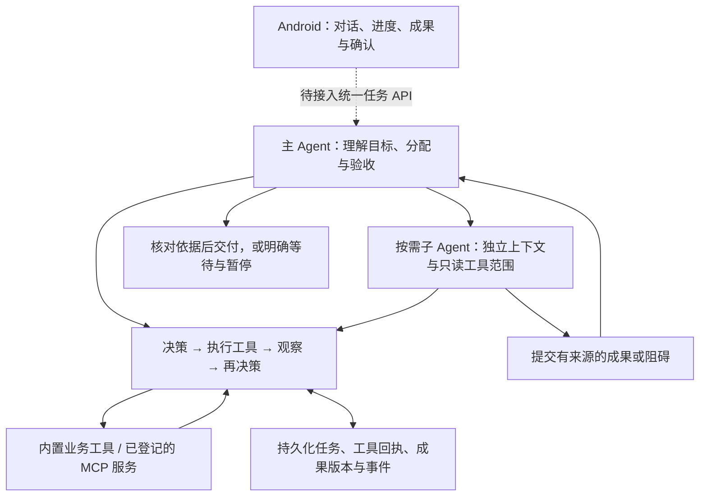
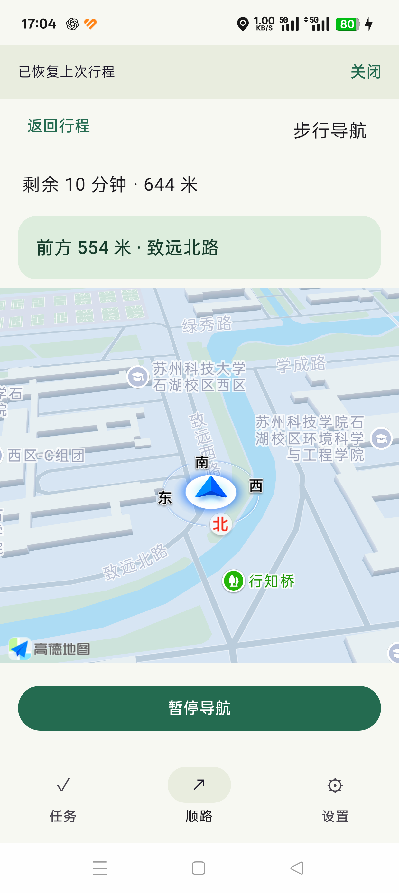
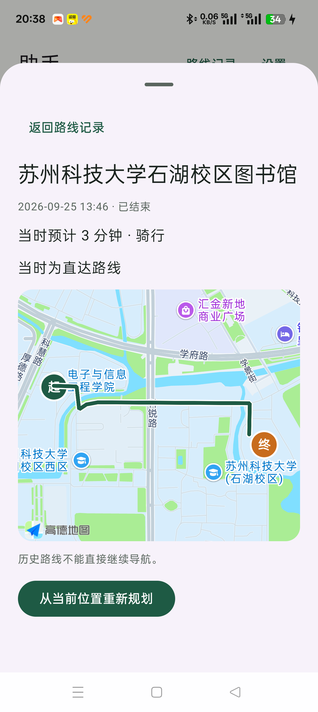

<h1 align="center">🧭 OnMyWay</h1>

<p align="center">
  <strong>从你的目标出发，把事情一步步办成。</strong><br/>
  正在构建由主 Agent 协调、按需委派子 Agent、借助工具持续推进任务的 AI Native 个人助手。<br/>
  服务端通用 Agent 与 MCP 能力正在验收；Android 已有对话、待办和导航，新任务入口尚待接入。
</p>

<p align="center">
  <a href="https://developer.android.com"></a>
  <a href="https://kotlinlang.org"></a>
  <a href="https://fastapi.tiangolo.com"></a>
  <a href="LICENSE"></a>
</p>

<p align="center">
  <a href="https://github.com/Carlos-fhy/OnMyWay/stargazers"></a>
  <a href="https://github.com/Carlos-fhy/OnMyWay/forks"></a>
</p>

<p align="center">
  <sub>Building an AI-native personal agent with server-side coordination, memory and tools.</sub><br/>
  <sub>Android 客户端 · Python 服务端 · 按需子 Agent · 单用户开发版</sub>
</p>

---

[开发方向](#开发方向) · [协作架构](#协作架构) · [开发阶段](#开发阶段) · [使用场景](#使用场景) · [界面预览](#界面预览) · [核心能力](#核心能力) · [技术栈](#技术栈) · [快速开始](#快速开始) · [当前状态与边界](#当前状态与边界) · [项目结构](#项目结构) · [文档与许可证](#文档与许可证)

## 开发方向

OnMyWay 的目标是 **AI Native Personal Agent**：用户表达目标，助手结合当前约束和相关记忆，自主选择可用工具，检查实际返回结果，调整计划并交付可修改的成果。待办、地图和导航是它可以使用的能力；后续通过 MCP 扩展其他领域的工具。

当前方案采用 **Android 客户端 + 服务端通用 Agent**。主 Agent 理解目标、分配任务、验收结果并交付成果；需要分工时，按任务创建具有独立身份、上下文和工具范围的子 Agent。子 Agent 的职责由本次目标决定，可以承担检索、比较、规划等工作，能力范围取决于已接入和获授权的工具。

后端保持 FastAPI 模块化单体，主、子 Agent 共用任务运行机制，无需为每个 Agent 单独部署服务。开发时后端运行在电脑上，后续部署到服务器提供持续服务；当前版本仍限制本机访问，远程部署配套尚未完成。

## 协作架构

下图表示目标分工。服务端循环和一层子 Agent 委派已有实现，Android 统一任务入口仍待接入。



- **通用任务循环**：持久化目标与修订，按预算发现工具、加载完整参数契约、执行并读取结果；支持取消、继续和中断恢复。
- **一层子 Agent 协作**：主 Agent 指定子任务目标、工具、输入证据与预算，读取指定版本成果后接受或拒绝。子 Agent 只使用获分配的服务端只读工具，不继承全部聊天或个人记忆；主、子任务共享总预算，当前由同一 worker 顺序调度。
- **工具与业务分工**：待办读取、地点搜索、路线试算和原执行查询已有内置适配器；高德与 Exa 官方 MCP 用于扩展查询能力。地图计算交给地图与规划服务，模型负责选择、组合和解释结果。
- **成果与执行分开**：成果支持版本更新，完成前独立核对内容、可见原始来源及实际调用事实。模型核对仍可能出错，必须通过真实场景验收；保存计划也不代表已经创建待办、预订或启动导航。

后台执行默认关闭。开启方式、子 Agent 开关及 MCP 范围见 [Agent 与 MCP 配置](docs/PUBLIC_SETUP.md#agent-与-mcp)。

## 开发阶段

**当前处于 A1，整体验收尚未通过。** 本地回归、真实模型与 MCP、Android 设备及实际出行分别验证。

| 阶段 | 目标 | 当前状态 |
| --- | --- | --- |
| **A1：通用 Agent 与 MCP** | 同一循环完成办事和旅行，支持工具选择、子任务委派、成果修改与故障恢复 | 后端基础与一层委派已有实现及本地验证；真实模型的成果事实、修订和主子协作仍在验收 |
| **A2：Android 统一任务入口** | 在持续对话中展示任务进度、成果、确认与恢复，逐步接管旧业务编排 | 待 A1 核心契约与必需验收稳定后接入；当前 App 仍走已有助手接口 |
| **A3：事件触发与日常部署** | 接收已授权事件，提供脱离开发电脑的服务与恢复能力 | 尚未交付；部署需补齐身份认证、HTTPS 和备份恢复 |

当前先完成 A1 的真实事实核查与修改闭环，再补齐草稿取消、来源指令边界和实际主子协作证据。详见 [开发方向与职责](docs/PUBLIC_SETUP.md#开发方向与职责)。

## 使用场景

两组场景用于检验通用 Agent 的能力：

| 场景 | 需要完成的闭环 |
| --- | --- |
| **取快递 + 打印论文 + 回宿舍** | 读取当前事项、查询地点并规划；移除打印停靠后保留快递与宿舍，正式打印待办仍未完成；取消未确认草稿仅移除该草稿 |
| **成都四天旅行，预算三千，别太累** | 补齐必要条件，自主查询地点与公开资料，核对日期、营业规则、交通和预算；修改第二天时保留其他三天，说明来源与未核实信息 |

上述为 A1 验收目标，不能视为当前 App 已提供完整通用规划体验。现有 Android 功能可按以下办事流程体验：

1. **记下要做的事**：说出「今天取快递，还要打印论文」，检查拆出的两条草稿，补充领取点、打印店和时间；可以逐项修改，也可以只确认其中一项。
2. **告诉助手去哪儿**：输入「我要回宿舍」，确认目的地，选择步行或骑行。
3. **决定怎么顺路**：查看可安排的事项、额外距离和预计耗时，选择要去的站点，确认路线后开始应用内导航。
4. **途中调整、结束核对**：需要时通过对话修改行程，重新试算并确认；行程结束后核对待办完成情况，未完成事项继续保留。

模型负责理解需求；地点、距离和预计路途时间来自地图服务，路线选择结合时间约束与办事时长计算。

## 界面预览

以下为现有 Android 对话、导航和记录界面；通用 Agent 的任务进度与成果入口将在 A2 接入。

| 小助手对话 | 应用内导航 | 行程记录 |
| :---: | :---: | :---: |
|  |  |  |

## 核心能力

以下能力对应当前 Android 与已有后端业务接口，通用 Agent 的实现范围见上方架构与开发阶段。

| 能力 | 你可以做什么 |
| --- | --- |
| 🎙️ 语音与文字录入 | 按住说话、松开识别，或直接输入文字；一次提出多个待办，逐项编辑和确认。 |
| ✅ 待办与提醒 | 按日期管理任务，设置提醒、稍后提醒或忽略本次提醒；提醒时间与计划日期、截止时间独立。 |
| 📍 地点与顺路规划 | 选择常用地点或搜索门店，查看顺路事项及额外距离、耗时；缺少办理地点的任务会说明原因，不直接进入路线。 |
| 🗺️ 导航与途中调整 | 使用高德地图和应用内导航；通过对话增减事项或更换目的地，试算并确认后更新路线。 |
| 🕘 中断恢复与历史 | 取回中断的对话请求，继续处理已保存的草稿；查看历史路线，并从当前位置重新规划。 |
| 💬 持续对话 | 对话不再按天自动重置；可以手动新建、回看和继续历史对话，未决请求和草稿需先处理。 |
| 📶 离线记录与电脑同步 | 本地保存待办、行程和对话，连接电脑后同步并重试未送达修改；重装可取回已经同步的记录。 |
| 🧠 个人记忆 | 连接个人服务后保存和召回适用的偏好、临时情境与经历；可以纠正、忘记，并分别控制参考记忆和自动保存。 |
| 🚶 出行偏好 | 分别设置步行、骑行的绕行预算；积累选择反馈，随时暂停或清空预算学习记录。 |

任务和路线都需要显式确认。重复确认会去重，过期回复不能覆盖新的草稿或行程。恢复后的路线需要重新定位、计算并确认，已结束的导航不会自动重启。

## 技术栈

| 层级 | 技术 |
| --- | --- |
| 客户端 | Kotlin 2.2 · Jetpack Compose · Material 3 · minSdk 26 / targetSdk 36 |
| 本地数据 | Room 2.7（显式迁移）· SharedPreferences · WorkManager 2.10 |
| 地图与导航 | 高德 Android SDK 11.2 · 高德 Web 服务 |
| 语音与意图 | Android 录音 · 后端调用云端 ASR · 兼容 Chat Completions 的文字模型接口 |
| 后端 | Python 3.11+ · FastAPI · Pydantic · SQLite |
| 路线优化 | Google OR-Tools |
| 构建与测试 | Gradle Kotlin DSL · JDK 17 · pytest · JUnit · AndroidX Instrumentation |

手机负责交互、离线存储和导航执行；Python 服务端负责 Agent 协调、模型与工具请求、路线计算及数据同步，开发时运行在电脑上。**本地优先指部分记录可保存在手机；Agent 运行依赖后端，语音识别、模型理解和在线算路仍依赖网络与配置的服务商。**

## 快速开始

以下以 **Windows PowerShell + USB Android 真机** 为例。克隆完成后，后续命令均在项目根目录执行。

### 1. 准备环境与配置

| 准备项 | 要求 |
| --- | --- |
| 开发环境 | Git、Python 3.11+、JDK 17、Android Studio、Android SDK 36；`adb` 可在终端调用 |
| 测试设备 | Android 8.0+（API 26），开启 USB 调试并授权电脑 |
| 地图服务 | 后端使用高德 **Web 服务 Key**；客户端使用 **Android SDK Key**，绑定包名 `com.onmyway.app` 与签名证书 SHA-1 |
| 模型服务 | 文字模型配置；使用语音时另需支持当前 Qwen 音频识别协议的服务 |
| 个人数据服务（记忆与同步需要） | 后端设置 `ONMYWAY_BACKUP_TOKEN`，至少 32 个随机字符；App 中输入相同口令 |

```powershell
git clone https://github.com/Carlos-fhy/OnMyWay.git
cd OnMyWay
python -m venv .venv
.\.venv\Scripts\python.exe -m pip install -r backend/requirements-dev.txt
if (-not (Test-Path backend/.env)) {
    Copy-Item backend/.env.example backend/.env
}
```

已有本地仓库可跳过克隆。编辑 `backend/.env`，填写自己的地图和模型配置；详细字段见 [本地开发指南](docs/PUBLIC_SETUP.md#后端)。

用 Android Studio 打开项目，在生成的 `local.properties` 中添加：

```properties
amap.android.key=YOUR_AMAP_ANDROID_SDK_KEY
```

Web 服务 Key 与 Android SDK Key 不能互换。仓库不包含服务凭据、真实用户数据或预配置 APK。

### 2. 启动后端

```powershell
.\.venv\Scripts\python.exe -m uvicorn backend.main:app --host 127.0.0.1 --port 8000
```

保持该终端运行，在另一终端检查：

```powershell
Invoke-RestMethod http://127.0.0.1:8000/health
```

应返回 `status: ok`。这只证明后端可访问；地图 Key、模型账号和语音服务的可用性仍需通过实际请求确认。

### 3. 安装 App 并验证手机连接

连接并授权一台 USB 手机后，在项目根目录执行：

```powershell
adb devices -l
.\gradlew.bat :app:installDebug
.\tools\check-device-backend.ps1
```

检查脚本会确认 App 已安装、电脑后端健康，恢复 `adb reverse tcp:8000 tcp:8000`，并从手机实际请求 `/health`。看到 `PASS` 才表示手机收到了 **HTTP 200** 且 `status=ok`。多设备连接时，使用 `-Serial <设备序列号>` 指定检查目标，并在安装时指定同一设备。

打开 App，在「设置 → 数据与连接」将服务地址设为 `http://127.0.0.1:8000` 并保存。需要个人记忆或业务同步时，输入数据服务口令并点击「连接并同步」。USB 重连或 ADB 重启后重新运行连接检查。

模拟器可使用 `http://10.0.2.2:8000`。本地 HTTP 联调使用 debug 构建；release 默认禁止明文请求。更多配置与排查说明见 [本地开发指南](docs/PUBLIC_SETUP.md)。

### 4. 运行开发检查

```powershell
.\.venv\Scripts\python.exe -m pytest -q
.\gradlew.bat :app:testDebugUnitTest :app:assembleDebug
```

仪器测试使用专用测试设备或模拟器，避免清理个人手机中的 App 数据。仪器测试后须重新安装 App 并完成连接检查，具体步骤见 [测试说明](docs/PUBLIC_SETUP.md#测试)。

## 当前状态与边界

当前为**单用户、本地开发版本**，服务端部署是后续目标。已有任务录入、路线建议、导航调整、恢复同步、持续对话和服务端个人记忆实现；完整语音体验、真实步行／骑行、多站连续导航及部分系统恢复场景仍待验收。Android 助手仍使用现有业务流程；新的通用 Agent 通过后端 `/agent` API 使用，尚未接入 App。

限定真实评测已有办事初版和移除打印停靠的通过样本，同时仍有重复发布、输出话术等质量问题。旅行已生成过四天成果，但事实依据与后续修订未通过完整验收，真实主子协作证据也未齐。后续上下文修复还需在最终代码上回归复测，**这些局部结果不代表 A1 或产品已经完成**。

- **路线范围**：当前客户端默认选取最多 6 个有效待办参与候选计算；这不等于导航 SDK 支持 6 个途经点。从地图返回的候选中计算方案，不保证全路网最短，导航 SDK 还会独立算路。
- **耗时估计**：额外总耗时包含用户填写的办事时长，尚未校验营业时间与实际排队时间。行程实际用时、距离已有采集实现，准确性仍需实走验证。
- **恢复范围**：已保存的草稿与请求可恢复，部分规划请求已有进程重启后核对原执行的实现与隔离模拟器证据；这不代表所有强停、系统回收和真实导航场景通过。导航调整的待确认方案有 30 分钟有效期，恢复后仍需重新定位和算路，恢复结果接回原确认入口仍有待完成项。
- **同步范围**：仅已送达电脑的记录可在重装后取回。设备请求日志、导航调整检查点和事件发送队列不在电脑业务快照中；版本冲突保留双方数据，尚无逐条合并、多用户账号或增量同步。历史版本与后端运行记录暂未设置自动保留期限。
- **记忆范围**：个人记忆单独保存在服务端，手机缓存用于离线查看；业务同步成功不代表记忆已备份。记忆的完整备份恢复尚未提供，忘记记忆也不会删除聊天原文。记忆不能代替最新业务状态或执行回执。
- **Agent 范围**：后端支持任务创建、修订、取消、恢复、逐次工具确认与事件查询；任务成果和工具回执分别记录。MCP 支持 Streamable HTTP 的 JSON 与有预算限制的 POST SSE 响应；不支持旧 GET SSE、stdio、OAuth 自动发现或服务端主动请求。远程地址须匹配已核查的官方来源注册表，loopback 仅用于本地测试服务；工具范围及读写影响由本地配置指定。`onmyway.read_execution` 可查询原执行及已核实设备回执，不会派发或启动导航。工具结果未知时停止推进，不自动重发；本地去重不保证外部服务恰好执行一次。Agent 数据库不在 `/sync` 快照中。
- **协作范围**：当前只支持一层只读子任务，使用共享总预算和显式证据授权；没有递归 Agent 集群、分布式并行调度或任意工具自动安装。可检索的信息取决于实际连接的服务、工具权限和来源可访问性。
- **数据与部署**：语音、对话和地点请求会按功能发送给配置的服务商；启用同步后，电脑 SQLite 会保存相关记录和历史版本。后端限制本机访问，尚无部署级用户鉴权和限流，不应直接开放公网。
- **后续能力**：真实模型与外部 MCP 的跨工具旅行规划验收、Android 统一任务与成果入口、已授权事件触发仍待完成；云端 TTS、免按键连续语音与通知自动提取也尚未交付。业务事件已有接收与排队发送实现，跨端联合验收及服务端业务确认仍未完成。

## 项目结构

```text
OnMyWay/
├── app/
│   └── src/main/java/com/onmyway/app/
│       ├── core/       通用模型、定位、语音与 UI
│       ├── data/       本地存储、远程接口、同步与事件
│       └── feature/    助手、待办、规划、导航与设置
├── backend/            FastAPI 模块化单体
│   ├── agent/          通用循环、主子任务、工具/MCP、上下文与成果核对
│   ├── assistant/      当前 Android 助手接口与请求恢复
│   ├── planning/       高德适配、候选筛选与路线计算
│   ├── execution/      执行身份、确认、回执与业务事件
│   ├── memory/         个人记忆及召回
│   ├── data_services/  正式待办、同步与备份
│   ├── evaluation/     固定回放与模型评测
│   └── tests/          按职责分类的后端回归
├── docs/               本地开发指南
├── tools/              评测、设备连接检查与转发维护脚本
├── assets/             README 界面截图
└── third_party/        第三方许可与说明
```

## 文档与许可证

| 文档 | 内容 |
| --- | --- |
| [后端目录与运行入口](backend/README.md) | 模块分类、测试与评测命令、数据位置 |
| [本地开发指南](docs/PUBLIC_SETUP.md) | 环境准备、配置、构建与测试命令 |
| [开发方向与职责](docs/PUBLIC_SETUP.md#开发方向与职责) | AI Native 目标、Harness 职责和首批验收边界 |
| [Agent 与 MCP](docs/PUBLIC_SETUP.md#agent-与-mcp) | 后台执行开关、工具配置、任务 API 与当前协议范围 |
| [存储与同步说明](docs/PUBLIC_SETUP.md#电脑主记录与手机同步) | 首次连接、断线重试、重装恢复与冲突边界 |
| [第三方说明](THIRD_PARTY_NOTICES.md) | 第三方依赖许可与服务条款 |
| [MIT License](LICENSE) | 项目原创代码许可证 |

项目原创代码采用 [MIT](LICENSE) 许可证。第三方依赖和服务遵循各自许可与条款，见 [第三方说明](THIRD_PARTY_NOTICES.md)。
