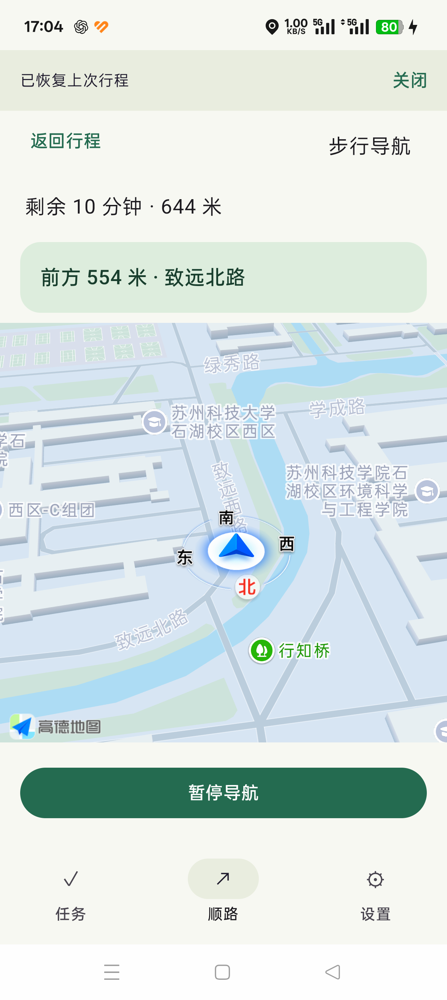
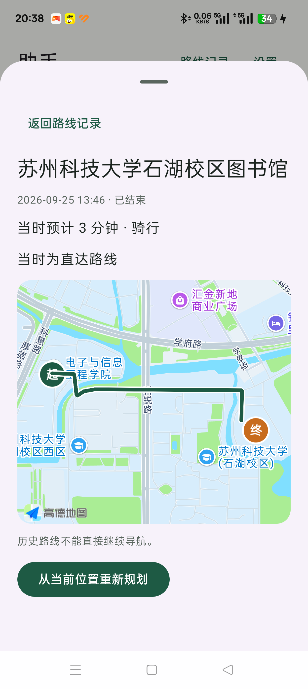

<h1 align="center">🧭 OnMyWay</h1>

<p align="center">
  <strong>出门时，把待办顺路办好。</strong><br/>
  用语音或文字记下需求，结合当前位置、目的地和出行方式，找到适合沿途完成的事情。<br/>
  先看建议，再确认任务与路线。
</p>

<p align="center">
  <a href="https://developer.android.com"></a>
  <a href="https://kotlinlang.org"></a>
  <a href="https://fastapi.tiangolo.com"></a>
  <a href="LICENSE"></a>
</p>

<p align="center">
  <a href="https://github.com/Carlos-fhy/OnMyWay/stargazers"></a>
  <a href="https://github.com/Carlos-fhy/OnMyWay/forks"></a>
</p>

<p align="center">
  <sub>A voice-first AI assistant for errands along the way.</sub><br/>
  <sub>Android 客户端 · Python 后端 · 本地优先 · 单用户开发版</sub>
</p>

---

[使用场景](#使用场景) · [界面预览](#界面预览) · [核心能力](#核心能力) · [技术栈](#技术栈) · [快速开始](#快速开始) · [当前状态与边界](#当前状态与边界) · [项目结构](#项目结构) · [文档与许可证](#文档与许可证)

## 使用场景

以「取快递 + 打印论文 + 回宿舍」为例：

1. **记下要做的事**：说出「今天取快递，还要打印论文」，检查拆出的两条草稿，补充领取点、打印店和时间；可以逐项修改，也可以只确认其中一项。
2. **告诉助手去哪儿**：输入「我要回宿舍」，确认目的地，选择步行或骑行。
3. **决定怎么顺路**：查看可安排的事项、额外距离和预计耗时，选择要去的站点，确认路线后开始应用内导航。
4. **途中调整、结束核对**：需要时通过对话修改行程，重新试算并确认；行程结束后核对待办完成情况，未完成事项继续保留。

模型负责理解需求；地点、距离和预计路途时间来自地图服务，路线选择结合时间约束与办事时长计算。

## 界面预览

| 小助手对话 | 应用内导航 | 行程记录 |
| :---: | :---: | :---: |
|  |  |  |

## 核心能力

| 能力 | 你可以做什么 |
| --- | --- |
| 🎙️ 语音与文字录入 | 按住说话、松开识别，或直接输入文字；一次提出多个待办，逐项编辑和确认。 |
| ✅ 待办与提醒 | 按日期管理任务，设置提醒、稍后提醒或忽略本次提醒；提醒时间与计划日期、截止时间独立。 |
| 📍 地点与顺路规划 | 选择常用地点或搜索门店，查看顺路事项及额外距离、耗时；缺少办理地点的任务会说明原因，不直接进入路线。 |
| 🗺️ 导航与途中调整 | 使用高德地图和应用内导航；通过对话增减事项或更换目的地，试算并确认后更新路线。 |
| 🕘 中断恢复与历史 | 取回中断的对话请求，继续处理已保存的草稿；查看历史路线，并从当前位置重新规划。 |
| 📶 离线记录与电脑同步 | 本地保存待办、行程和对话，连接电脑后同步并重试未送达修改；重装可取回已经同步的记录。 |
| 🧠 可控的偏好学习 | 分别设置步行、骑行的绕行预算；积累选择反馈，随时暂停或清空学习记录。 |

任务和路线都需要显式确认。重复确认会去重，过期回复不能覆盖新的草稿或行程。恢复后的路线需要重新定位、计算并确认，已结束的导航不会自动重启。

## 技术栈

| 层级 | 技术 |
| --- | --- |
| 客户端 | Kotlin 2.2 · Jetpack Compose · Material 3 · minSdk 26 / targetSdk 36 |
| 本地数据 | Room 2.7（显式迁移）· SharedPreferences · WorkManager 2.10 |
| 地图与导航 | 高德 Android SDK 11.2 · 高德 Web 服务 |
| 语音与意图 | Android 录音 · 后端调用云端 ASR · 兼容 Chat Completions 的文字模型接口 |
| 后端 | Python 3.11+ · FastAPI · Pydantic · SQLite |
| 路线优化 | Google OR-Tools |
| 构建与测试 | Gradle Kotlin DSL · JDK 17 · pytest · JUnit · AndroidX Instrumentation |

手机负责交互、离线存储和导航执行；电脑后端负责模型与地图请求、路线计算及数据同步。**本地优先指记录可保存在手机，语音识别、模型理解和在线算路仍依赖网络与配置的服务商。**

## 快速开始

以下以 **Windows PowerShell + USB Android 真机** 为例。克隆完成后，后续命令均在项目根目录执行。

### 1. 准备环境与配置

| 准备项 | 要求 |
| --- | --- |
| 开发环境 | Git、Python 3.11+、JDK 17、Android Studio、Android SDK 36；`adb` 可在终端调用 |
| 测试设备 | Android 8.0+（API 26），开启 USB 调试并授权电脑 |
| 地图服务 | 后端使用高德 **Web 服务 Key**；客户端使用 **Android SDK Key**，绑定包名 `com.onmyway.app` 与签名证书 SHA-1 |
| 模型服务 | 文字模型配置；使用语音时另需支持当前 Qwen 音频识别协议的服务 |
| 电脑数据同步（可选） | 后端设置 `ONMYWAY_BACKUP_TOKEN`，至少 32 个随机字符；App 中输入相同口令 |

```powershell
git clone https://github.com/Carlos-fhy/OnMyWay.git
cd OnMyWay
python -m venv .venv
.\.venv\Scripts\python.exe -m pip install -r backend/requirements-dev.txt
if (-not (Test-Path backend/.env)) {
    Copy-Item backend/.env.example backend/.env
}
```

已有本地仓库可跳过克隆。编辑 `backend/.env`，填写自己的地图和模型配置；详细字段见 [本地开发指南](docs/PUBLIC_SETUP.md#后端)。

用 Android Studio 打开项目，在生成的 `local.properties` 中添加：

```properties
amap.android.key=YOUR_AMAP_ANDROID_SDK_KEY
```

Web 服务 Key 与 Android SDK Key 不能互换。仓库不包含服务凭据、真实用户数据或预配置 APK。

### 2. 启动后端

```powershell
.\.venv\Scripts\python.exe -m uvicorn backend.main:app --host 127.0.0.1 --port 8000
```

保持该终端运行，在另一终端检查：

```powershell
Invoke-RestMethod http://127.0.0.1:8000/health
```

应返回 `status: ok`。这只证明后端可访问；地图 Key、模型账号和语音服务的可用性仍需通过实际请求确认。

### 3. 安装 App 并验证手机连接

连接并授权一台 USB 手机后，在项目根目录执行：

```powershell
adb devices -l
.\gradlew.bat :app:installDebug
.\tools\check-device-backend.ps1
```

检查脚本会确认 App 已安装、电脑后端健康，恢复 `adb reverse tcp:8000 tcp:8000`，并从手机实际请求 `/health`。看到 `PASS` 才表示手机收到了 **HTTP 200** 且 `status=ok`。多设备连接时，使用 `-Serial <设备序列号>` 指定检查目标，并在安装时指定同一设备。

打开 App，将服务地址设为 `http://127.0.0.1:8000`。需要电脑同步时，在「设置 → 电脑数据同步」输入口令并连接。USB 重连或 ADB 重启后重新运行连接检查。

模拟器可使用 `http://10.0.2.2:8000`。本地 HTTP 联调使用 debug 构建；release 默认禁止明文请求。更多配置与排查说明见 [本地开发指南](docs/PUBLIC_SETUP.md)。

### 4. 运行开发检查

```powershell
.\.venv\Scripts\python.exe -m pytest -q
.\gradlew.bat :app:testDebugUnitTest :app:assembleDebug
```

仪器测试使用专用测试设备或模拟器，避免清理个人手机中的 App 数据。仪器测试后须重新安装 App 并完成连接检查，具体步骤见 [测试说明](docs/PUBLIC_SETUP.md#测试)。

## 当前状态与边界

当前为**单用户、本地开发版本**。已有任务录入、路线建议、导航调整和恢复同步实现；完整语音体验、真实步行／骑行、多站连续导航及部分系统恢复场景仍待验收。

- **路线范围**：当前客户端默认选取最多 6 个有效待办参与候选计算；这不等于导航 SDK 支持 6 个途经点。从地图返回的候选中计算方案，不保证全路网最短，导航 SDK 还会独立算路。
- **耗时估计**：额外总耗时包含用户填写的办事时长，尚未校验营业时间与实际排队时间。行程实际用时、距离已有采集实现，准确性仍需实走验证。
- **恢复范围**：已保存的草稿与请求可恢复；强停或滑掉 App 后，不保证自动恢复编辑弹层和未提交输入。导航调整的待确认方案有 30 分钟有效期，恢复后仍需重新定位和算路。
- **同步范围**：仅已送达电脑的记录可在重装后取回。设备请求日志、导航调整检查点和事件发送队列不在电脑业务快照中；版本冲突保留双方数据，尚无逐条合并、多用户账号或增量同步。历史版本与后端运行记录暂未设置自动保留期限。
- **数据与部署**：语音、对话和地点请求会按功能发送给配置的服务商；启用同步后，电脑 SQLite 会保存相关记录和历史版本。后端限制本机访问，尚无部署级用户鉴权和限流，不应直接开放公网。
- **后续能力**：云端 TTS、免按键连续语音、通知自动提取和长期用户模型尚未交付。业务事件已有接收与排队发送实现，跨端联合验收及服务端业务确认仍未完成。

## 项目结构

```text
OnMyWay/
├── app/
│   └── src/main/java/com/onmyway/app/
│       ├── core/       通用模型、定位、语音与 UI
│       ├── data/       本地存储、远程接口、同步与事件
│       └── feature/    助手、待办、规划、导航与设置
├── backend/            FastAPI 服务与后端测试
├── docs/               本地开发指南
├── tools/              设备连接检查与转发维护脚本
├── assets/             README 界面截图
└── third_party/        第三方许可与说明
```

## 文档与许可证

| 文档 | 内容 |
| --- | --- |
| [本地开发指南](docs/PUBLIC_SETUP.md) | 环境准备、配置、构建与测试命令 |
| [存储与同步说明](docs/PUBLIC_SETUP.md#电脑主记录与手机同步) | 首次连接、断线重试、重装恢复与冲突边界 |
| [第三方说明](THIRD_PARTY_NOTICES.md) | 第三方依赖许可与服务条款 |
| [MIT License](LICENSE) | 项目原创代码许可证 |

项目原创代码采用 [MIT](LICENSE) 许可证。第三方依赖和服务遵循各自许可与条款，见 [第三方说明](THIRD_PARTY_NOTICES.md)。
